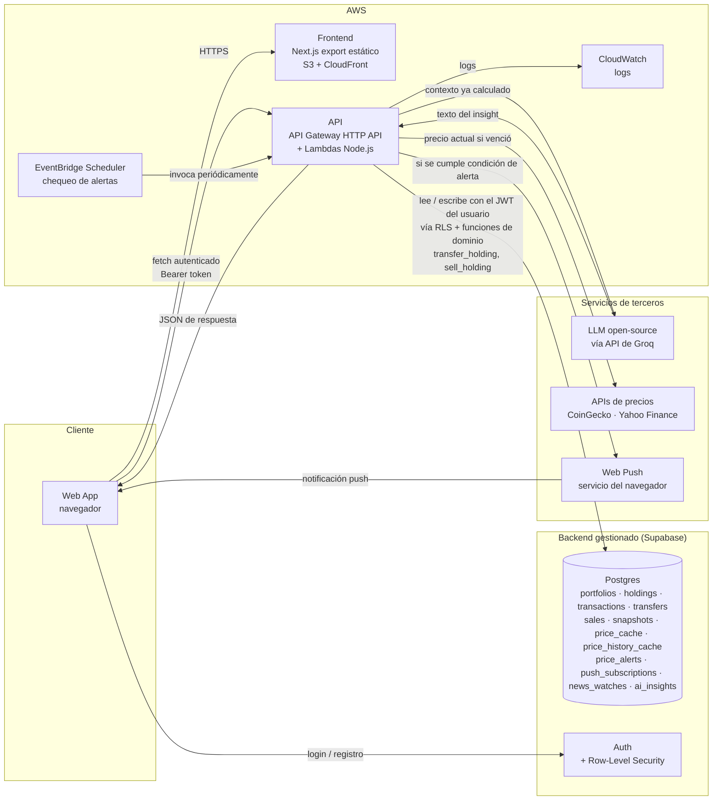

# Definición de Arquitectura — StonksView

TPI Desarrollo de Software Cloud (UTN FRLP, 2026)

Esta es la arquitectura de todo el proyecto, no un recorte para una entrega puntual — es literalmente la base sobre la que se construye StonksView, apoyada en el esquema de datos ya existente de Mía.

---

## 1. Diagrama de arquitectura

## 2. Decisiones de arquitectura

- **Multi-portfolio por usuario:** cada holding, transacción, transferencia, venta y snapshot cuelga de un `portfolio_id`, no directo de `user_id` — un usuario puede tener más de una cartera (ej. una personal y otra para un fondo familiar). La seguridad se resuelve verificando que el portfolio le pertenece al usuario autenticado, no comparando `user_id` directo en cada tabla de dominio.
- **Lógica de dominio en funciones de Postgres, no en el backend:** operaciones que tienen que ser atómicas y consistentes — transferir una tenencia entre sedes preservando costo base, o vender con cálculo de ganancia realizada FIFO/LIFO — viven como funciones en la base (`transfer_holding`, `sell_holding`) que el backend invoca vía RPC. Si esa lógica viviera en una función serverless que lee, calcula y escribe en pasos separados, dos requests simultáneos sobre el mismo holding podrían pisarse; adentro de una función de Postgres, la transacción de la base lo evita.
- **Prisma solo para schema y migraciones, nunca para queries en runtime:** las queries de la app pasan por el cliente de Supabase con el token del usuario, que es lo que hace que RLS se aplique automáticamente. Una conexión directa de Prisma con el `DATABASE_URL` no lleva ese contexto de sesión y podría bypassear RLS si se la usara para leer o escribir en producción — por eso Prisma queda limitado a generar tipos y versionar el schema.
- **Frontend estático, backend en Lambda:** el frontend no tiene lógica de servidor (la sesión la maneja Supabase Auth en el navegador y los datos vienen de la API), así que se exporta como archivos estáticos a S3 y se sirve por CloudFront. La API son Lambdas detrás de API Gateway, definidas con SAM. La lógica vive en `backend/src/core` y los handlers son adaptadores finos: si AWS no funcionara (Plan B), el mismo core se monta en Vercel sin reescribirlo.
- **Proceso programado, no contenedor persistente:** las alertas de precio necesitan un chequeo periódico. Eso no exige un servidor corriendo 24/7: **EventBridge Scheduler** invoca una Lambda cada cierto tiempo; el resto del backend sigue siendo serverless puro, sin nada esperando eventos entre un request y el siguiente.
- **Precios bajo demanda con cache:** el endpoint de métricas refresca los precios que tienen más de 5 minutos (CoinGecko para cripto, Yahoo Finance para acciones, ETF y CEDEAR) y los guarda en `price_cache`. Si la API falla o tarda, se usa el último precio guardado y el dashboard muestra su fecha. Como `price_cache` es compartida entre usuarios, solo la escribe el backend con la `service_role`: RLS no deja escribirla a los usuarios, porque cualquiera podría falsear el precio de todos.
- **La IA nunca calcula, solo interpreta:** el LLM recibe como contexto las métricas que ya calculó el backend (patrimonio por sede, ganancia no realizada, concentración de riesgo) y devuelve texto — nunca un número nuevo. Evita que una alucinación del modelo se disfrace de dato financiero.
- **Sin base vectorial:** una base vectorial está pensada para búsqueda por similitud semántica sobre contenido no estructurado — texto, documentos, embeddings de imágenes — donde la pregunta es "¿qué se parece a esto?". El dominio de StonksView es lo opuesto: datos numéricos estructurados donde la pregunta es "¿cuánto sumo, exactamente?" (patrimonio total, ganancia no realizada, composición por sede). Convertir esos números en un embedding para buscar "similitud" no tiene sentido — se pierde precisión y no hay forma de garantizar una suma exacta desde un resultado de similitud. Una base relacional con `SUM`/`GROUP BY` resuelve esto de forma exacta y determinística, que es justo lo que hace falta antes de mandarle el resumen al LLM.
- **Degradación elegante como requisito:** si la API del LLM no responde, el endpoint de insight devuelve un estado explícito ("no disponible") sin romper el resto del dashboard, que es 100% determinístico.

## 3. Flujos principales

### 3.1 Generar un insight

1. El usuario abre el dashboard → el frontend pide su resumen de cartera a la API con su token de sesión.
2. La función de backend valida la sesión, consulta las tenencias del portfolio (con RLS aplicado automáticamente), y calcula patrimonio total, composición por sede y por clase de activo.
3. El usuario pide un insight → el backend arma un prompt con esas métricas ya calculadas (sin datos personales identificables, solo montos y símbolos) y llama al modelo con un timeout corto.
4. Si responde a tiempo: se guarda el insight en `ai_insights` (auditable) y se devuelve al frontend. Si no responde o excede el límite diario del usuario: se devuelve un estado de "no disponible" sin romper el resto del dashboard.

### 3.2 Transferencia interna

1. El usuario mueve un activo de una sede propia a otra.
2. La API valida sesión y verifica que el holding de origen pertenece a un portfolio del usuario.
3. Invoca `transfer_holding` vía RPC con el holding de origen, la sede destino y la cantidad.
4. La función actualiza o crea el holding destino preservando costo base y fecha de adquisición, y registra la fila en `transfers`.

### 3.3 Venta (operación de mercado real)

1. El usuario vende una tenencia, indicando método FIFO o LIFO.
2. La API invoca `sell_holding` vía RPC.
3. La función consume los lotes correspondientes, calcula `proceeds`, `cost_basis` y `realized_gain`, guarda el detalle de qué lotes se consumieron en `lots_consumed` (jsonb) y crea la fila en `sales`.

### 3.4 Chequeo de alertas (proceso programado)

1. EventBridge Scheduler invoca la Lambda de chequeo periódicamente.
2. La función trae las alertas con `active = true`, junto con el precio cacheado de cada símbolo (o lo refresca si venció).
3. Por cada alerta, evalúa la condición (`above`/`below` contra `target_price`, o variación porcentual contra `base_price`).
4. Si se cumple: busca las suscripciones push del usuario y envía la notificación; marca `triggered_at`. Si no hay suscripción activa o el envío falla, no rompe el resto del chequeo — sigue con la próxima alerta.

## 4. Requisitos no funcionales clave

| Dimensión | Requisito |
|---|---|
| Seguridad de datos | Row-Level Security por portfolio; secretos de servidor (incluida `DATABASE_URL` de Prisma) nunca en variables públicas del frontend. |
| Costo | Alarma de presupuesto en AWS Budgets; rate limit por usuario/día en el endpoint de IA; Lambdas y el scheduler cobran por invocación, sin cómputo ocioso entre corridas. |
| Resiliencia | Timeout corto + circuit breaker en la llamada al LLM; el resto del producto no depende de esa disponibilidad. El chequeo de alertas es idempotente: una corrida fallida no duplica notificaciones, se re-evalúa en la siguiente. |
| Observabilidad mínima | Endpoint de `/health` verificado post-deploy; logs de cada Lambda en CloudWatch (retención de 14 días); log de qué contexto se envió a la IA, para poder auditar. |

---

## 5. Stack tecnológico

| Capa | Tecnología | Razón de uso |
|---|---|---|
| Frontend / hosting | Next.js con `output: "export"`, en S3 + CloudFront | La app es solo cliente: archivos estáticos detrás de una CDN, sin servidor que mantener. Una CloudFront Function resuelve `<ruta>/index.html` para cada página. |
| Backend / API | API Gateway (HTTP API) + AWS Lambda (Node.js 22, arm64), definidas con AWS SAM y bundleadas con esbuild | Serverless con pago por request; la infraestructura queda versionada en `template.yaml`. |
| Persistencia + autenticación | Supabase (Postgres + Auth + RLS) | Datos e identidad en un solo proveedor; RLS resuelve de forma nativa el requisito de seguridad más importante del dominio. |
| ORM / migraciones | Prisma (solo schema y migraciones, nunca queries en runtime) | Tipado de los modelos y control de versiones del schema, sin arriesgar el bypass de RLS que implicaría usarlo para leer/escribir en producción. |
| Precios | CoinGecko y Yahoo Finance (APIs públicas, sin clave), cacheados en `price_cache` | Valuación automática con 5 minutos de vigencia y degradación al último precio guardado. |
| Scheduler | Amazon EventBridge Scheduler | Invoca la Lambda de chequeo de alertas sin un proceso persistente. |
| Notificaciones | Web Push (`web-push`, VAPID keys) | Estándar del navegador, sin servicio de notificaciones separado para este volumen. |
| IA | Modelo open-source (Llama) servido por la API de Groq | Sin costo por token de un proveedor cerrado y con baja latencia; el modelo no se autohospeda, se consume por API con timeout corto y degradación a "no disponible". |
| CI/CD | GitHub Actions | CI (lint, typecheck, tests, `sam validate` y build) en cada PR; deploy al mergear a `main` (SAM + frontend a S3 + invalidación de CloudFront + verificación de `/health`). Se usan access keys de un usuario IAM acotado a recursos `stonksview-*`, porque la SCP del plan free de AWS bloquea crear el proveedor OIDC. |
| Observabilidad | Amazon CloudWatch | Logs de cada Lambda; alarma de errores y dashboard básico (tarea 2.4). |

### Planes B

| Pieza | Plan A (actual) | Plan B |
|---|---|---|
| Frontend | S3 + CloudFront | Vercel |
| Backend | API Gateway + Lambda (SAM) | Vercel, reutilizando `backend/src/core` |
| Scheduler de alertas | EventBridge Scheduler | GitHub Actions schedule o Vercel Cron |
